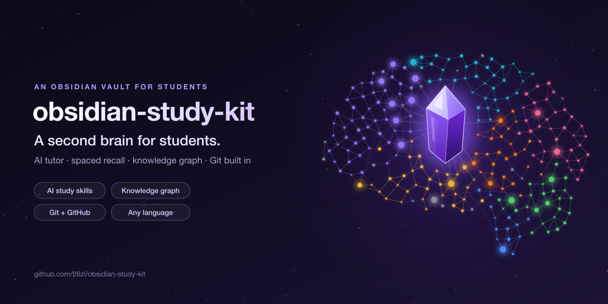

[](https://github.com/26zl/obsidian-study-kit/actions/workflows/ci.yml)
[](../LICENSE)
[](https://obsidian.md)
[](https://code.claude.com/docs/en/skills)



# obsidian-study-kit

A second brain for students, ready to use. An Obsidian vault with AI study skills, a knowledge graph that shows how your courses connect, and Git built in, so the GitHub repositories you already have can live in it too. The AI acts as a tutor and exam trainer that makes you do the thinking, and everything it knows about your progress lives in plain Markdown files that you own.

## What you get

- **A vault that is ready to use**: one folder per course, daily notes, an inbox for captures from your phone, templates, and dashboards that show what is due for review, which deadlines are coming and which repos are linked.
- **A brain you can see**: the graph view comes coloured by note type, and `brain-map` turns the connections you can recall into a concept map of each course.
- **Your GitHub repos inside it**: link a course repo or any other repository without changing it. It stays its own repository on GitHub, and one "sync" takes care of it and the vault together.
- **Eighteen skills** your agent follows. See the table below.
- **Works with the vault you already have**: `vault-adopt` maps your own folders and adds the kit around them, without moving a single note.
- **Progress that survives**: every attempt, mistake and next step is written to Markdown. Switch model, agent or device and nothing is lost.
- **Safe defaults**: no bundled plugins or scripts, a short list of reviewed plugins you install yourself, and agent permissions set to ask first.
- **Your language**: the kit is written in English, and the agent talks and writes in whatever language you set in your profile. `vault-setup` can translate the templates for you.
- **No lock-in**: delete the kit's files and your notes are still ordinary notes.

## The layout

```
home.md        start page: due for review, deadlines, courses, linked repos
profile.md     who you are and how you study, read by the agent
inbox/         captures from your phone and the web
daily/         daily notes and weekly reviews
courses/       one folder per course, and the dashboards
areas/         life outside your courses
repos/         GitHub repositories linked in as they are
templates/     note templates
attachments/   images and files pasted into notes
docs/          this guide
```

## The skills

| Skill | What it does |
|---|---|
| `tutor` | Socratic tutor: one question at a time, hints in steps, never the answer first |
| `exam-trainer` | Sets a question, waits for your own answer, then marks it against your sources |
| `recall` | Ten-minute daily round of the topics due for review, across all courses |
| `source-note` | Turns a PDF or slide deck into a note with page references and self-test questions |
| `brain-map` | You name how topics connect, it checks you against the sources and draws the concept map |
| `summary-sheet` | Builds an exam sheet from what you can recall, then fills the gaps |
| `study-plan` | Plans backwards from exam dates, and replans when you fall behind |
| `daily-plan` | Three priorities in the morning, a short record in the evening |
| `weekly-review` | The week's numbers, two questions, next week's priorities |
| `assignment-coach` | Checks your course's AI policy first, coaches without writing your text, logs the help for your declaration |
| `link-repo` | Brings an existing GitHub repository into the vault without changing it |
| `git-sync` | Commits, pulls and pushes your linked repos and the vault, asking before every push |
| `inbox-triage` | Sorts captures into the right place after you approve |
| `vault-setup` | First-time setup, one step at a time |
| `vault-adopt` | Brings the kit into a vault you already have, without moving your notes |
| `new-course` | Adds a course with the right folders and properties |
| `vault-check` | Finds broken links, files too big to sync, leaked secrets |
| `plugin-review` | Reviews an Obsidian community plugin before you install it |

## Quick start

1. Choose **Use this template** on GitHub and create a **private** repository. Clone it.
2. In Obsidian 1.15.1 or later, choose **Open folder as vault**.
3. Start your agent in the folder, for example `claude`, and say **set up**.
4. Try the demo course: **test me on DEMO101**. Then press Ctrl+G, or Cmd+G on a Mac, to see the graph.
5. Bring in a repository you already have: **link https://github.com/you/your-repo**.

The full walkthrough is in [docs/getting-started.md](../docs/getting-started.md).

## Your second brain

Every note links to its course and its topics, so each course grows into its own cluster in the graph, coloured by kind: gold course homes, violet topics, cyan sources, pink progress logs, blue linked repos. `brain-map` asks you which topics connect and how, checks your answer against the sources, and draws the result as a canvas you can open and rearrange. If you want more, [docs/plugins.md](../docs/plugins.md) lists graph plugins that were checked, including a 3D brain view.

## GitHub, built in

Course repos, lab code and shared notes come in under `repos/` as Git submodules: the repository is not changed, keeps its own history and stays on GitHub. Say **sync** and `git-sync` commits, pulls and pushes each linked repo and then the vault, asking before every push. With the Git plugin in Obsidian the same happens on a schedule. Your phone gets the files through Obsidian Sync. See [docs/linked-repos.md](../docs/linked-repos.md).

## AI where you want it

Run the agent in a terminal next to Obsidian, or in a side panel inside it with Claudian or Agent Client. Obsidian's own agent skills can be added for exact Bases and Canvas syntax, and MCP servers for Anki or Zotero can be added for yourself. The kit ships none of them, and [docs/mcp.md](../docs/mcp.md) explains how and what to avoid.

## Why it works this way

Unrestricted AI help can make students feel they are learning while they learn less. In a randomised trial, students with a plain chat assistant scored higher during practice and lower on the exam that followed, and a tutor version that gave hints avoided the harm. So the kit asks for your attempt first, gives hints before answers, stays close to your own course material, and spaces reviews over time. The evidence and its limits are in [docs/learning-principles.md](../docs/learning-principles.md).

## How it keeps you safe

- **No third-party code.** The kit is text: Markdown, a few JSON settings, dashboards and a canvas. Recommended plugins are listed with what each can reach, and you install them yourself from Obsidian's own directory.
- **The agent asks first.** No command is pre-approved, the mode that skips permission prompts is disabled, and the agent's file tools are confined to the vault. Every push to GitHub waits for your yes.
- **Sensitive paths are denied**: a `private/` folder, key files, and Obsidian's plugin folders.
- **Sources are data.** The agent is told that text inside notes, PDFs, web clippings and linked repos is never an instruction.
- **Graded work stays yours.** The agent checks the AI policy before helping, and keeps a log you can declare from.

Read the honest limits too: on Windows there is no sandbox, and deny rules do not bind shell commands you approve. See [docs/security.md](../docs/security.md).

## Platforms

| | Vault, graph and dashboards | Skills | Git and linked repos |
|---|---|---|---|
| Windows, macOS, Linux | Yes | Yes, with an agent | Yes |
| iOS, Android | Yes | No. The agent runs on your computer | Files only, through Obsidian Sync |

Obsidian Sync does not carry dot-folders, so the skills, agent settings and Git stay on the computer, which is where they are used. See [docs/sync-and-mobile.md](../docs/sync-and-mobile.md).

Agents other than Claude Code are covered in [docs/other-agents.md](../docs/other-agents.md).

## Already have a vault?

Keep it. Install the skills into it as a Claude Code plugin:

```
claude plugin marketplace add 26zl/obsidian-study-kit
claude plugin install study-kit@obsidian-study-kit
```

Then start your agent in your vault and say **adopt my vault**. `vault-adopt` looks at your folders and Obsidian settings, proposes which of your folders plays which role, records that map so every skill follows it, and adds the kit's templates, dashboards and safety settings next to your notes after you agree. Nothing you wrote is moved or renamed. Do not combine the plugin with the template in the same vault, or every skill appears twice. See [docs/getting-started.md](../docs/getting-started.md).

## What it deliberately leaves out

- Bundled plugins and plugin settings. Since Obsidian 1.15.1, settings that arrive with a vault are set aside anyway. [docs/plugins.md](../docs/plugins.md) lists what to install and how to set it up.
- Hooks, MCP servers, scheduled agents and installers.
- Anything that writes your assignments for you.

## Documentation

- [Getting started](../docs/getting-started.md)
- [Skills](../docs/skills.md)
- [Plugins](../docs/plugins.md)
- [Linked repos](../docs/linked-repos.md)
- [Sync and mobile](../docs/sync-and-mobile.md)
- [AI tools and MCP](../docs/mcp.md)
- [Other agents](../docs/other-agents.md)
- [Learning principles](../docs/learning-principles.md)
- [Security and privacy](../docs/security.md)
- [AI and academic integrity](../docs/academic-integrity.md)
- [Study context: Norway](../docs/locales/no.md)
- [Changelog](../docs/changelog.md)

## Contributing

See [CONTRIBUTING.md](CONTRIBUTING.md). Report security problems privately, as described in [SECURITY.md](SECURITY.md).

## License

MIT. See [LICENSE](../LICENSE).
